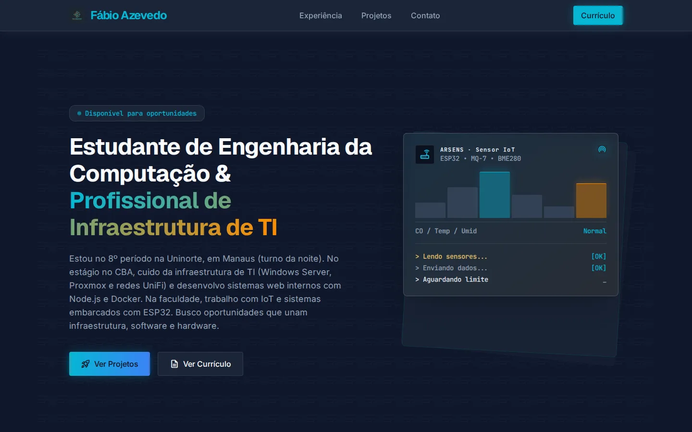

# Portfolio - Fábio Azevedo

Portfólio pessoal desenvolvido com React, Vite e Tailwind CSS. Apresenta experiência profissional, projetos acadêmicos (TCC IoT) e conquistas técnicas (Robô Sumô).

🔗 **Site:** [2026portfolio-indol.vercel.app](https://2026portfolio-indol.vercel.app/)

## 📸 Preview



## 🚀 Tecnologias

| Categoria | Ferramentas |
|-----------|-------------|
| **Core** | React 19, TypeScript, Vite 8 |
| **Styling** | Tailwind CSS 3.4, CSS Variables (Design System customizado) |
| **Tooling** | oxlint, tsc, PostCSS, Autoprefixer |
| **Fonts** | Geist, Inter, JetBrains Mono (Fontsource, servidas pelo site), Material Symbols |

## ✨ Funcionalidades

- **Hero Section** — Apresentação com demonstração visual animada de sensor IoT (ESP32 + MQTT)
- **Experiência Profissional** — Cards com tecnologias e tooltips interativos (hover + touch)
- **Projetos** — TCC [ARSENS](https://projeto-arsens-kappa.vercel.app/) (ESP32, MQ-7, BME280, Next.js, Telegram) + WordPress/UniFi Captive Portal
- **Conquistas** — 2º lugar em Robô Sumô (Arduino, sensores IR, estratégia autônoma)
- **HoverTooltip** — Componente reutilizável acessível (hover, toque e teclado)
- **Sistemas internos do CBA** — Estudos de caso do EstacionamentoCBA e do TermoCBA com galeria de telas
- **Contato** — Chamada para email (com botão de copiar), LinkedIn, GitHub e currículo
- **Currículo** — PDF disponível para abrir/baixar direto do site
- **Design System** — Dark mode nativo, glassmorphism, grid de rede sutil, tipografia hierárquica

## 📁 Estrutura

```
portfolio/
├── src/
│   ├── App.tsx                    # Layout principal (header, menu mobile, footer)
│   ├── main.tsx                   # Entry point
│   ├── index.css                  # Design system (CSS vars, utilities, components)
│   ├── data/
│   │   └── links.ts               # Links de contato e currículo
│   └── components/
│       ├── Hero.tsx               # Seção inicial + demo IoT
│       ├── Experience.tsx         # Cards de experiência
│       ├── ProjectsAndAchievements.tsx  # Projetos + conquistas
│       ├── CaseStudy.tsx          # Card de estudo de caso
│       ├── ImageGallery.tsx       # Galeria com imagem ampliada
│       ├── Contact.tsx            # Seção de contato
│       └── HoverTooltip.tsx       # Tooltip acessível
├── public/                        # Assets estáticos (logo, favicon, fotos, currículo PDF)
├── package.json
├── tailwind.config.js             # Tokens de cor, tipografia e animações
├── vite.config.js
└── postcss.config.js

identidade_visual/                 # Protótipos e logo original
docs/prompts.md                    # Prompts usados na construção do site
```

## ⚙️ Como rodar localmente

### Pré-requisitos
- Node.js 18+
- npm 9+

### Passos

```bash
# 1. Entre na pasta do projeto
cd portfolio

# 2. Instale as dependências
npm install

# 3. Inicie o servidor de desenvolvimento
npm run dev
```

O projeto estará disponível em `http://localhost:5173`

## 📦 Scripts disponíveis

| Comando | Descrição |
|---------|-----------|
| `npm run dev` | Inicia servidor de desenvolvimento (Vite) |
| `npm run build` | Verifica os tipos e gera o build de produção em `dist/` |
| `npm run lint` | Executa oxlint para análise de código |
| `npm run typecheck` | Verifica os tipos com TypeScript |
| `npm run preview` | Visualiza build de produção localmente |

## 🌐 Deploy

O site está publicado na [Vercel](https://2026portfolio-indol.vercel.app/), com deploy automático a cada push na `main`. Uma GitHub Action (`.github/workflows/ci.yml`) roda lint, typecheck e build em cada push e pull request. O build de produção é gerado na pasta `portfolio/dist/` com `npm run build` e pode ser hospedado em qualquer servidor estático.

## 📫 Contato

- **GitHub:** [github.com/fabioazevedo26](https://github.com/fabioazevedo26)
- **LinkedIn:** [linkedin.com/in/fabio-azevedo-8b7407241](https://www.linkedin.com/in/fabio-azevedo-8b7407241)
- **Email:** fabiorodriges08@gmail.com

---

*Desenvolvido por Fábio Azevedo — Estudante de Engenharia da Computação (Uninorte, 8º período)*
